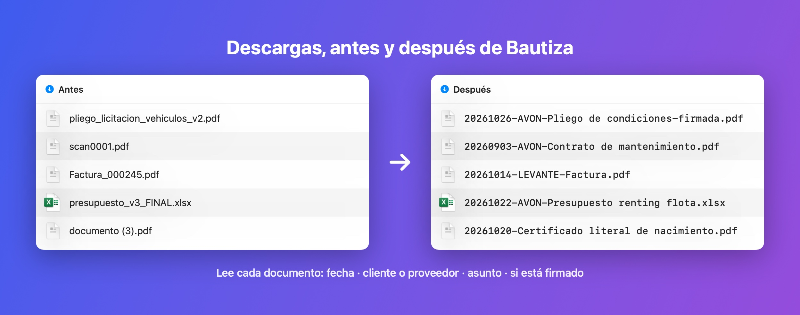
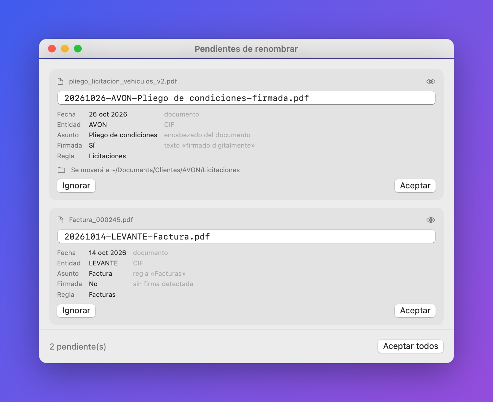
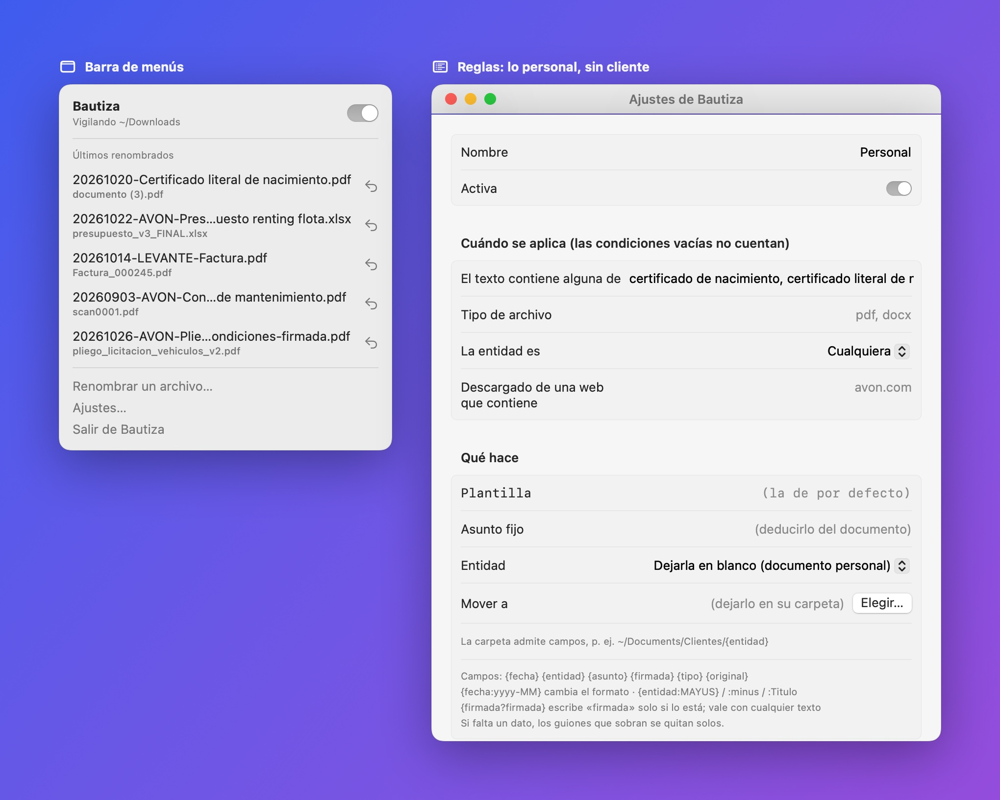
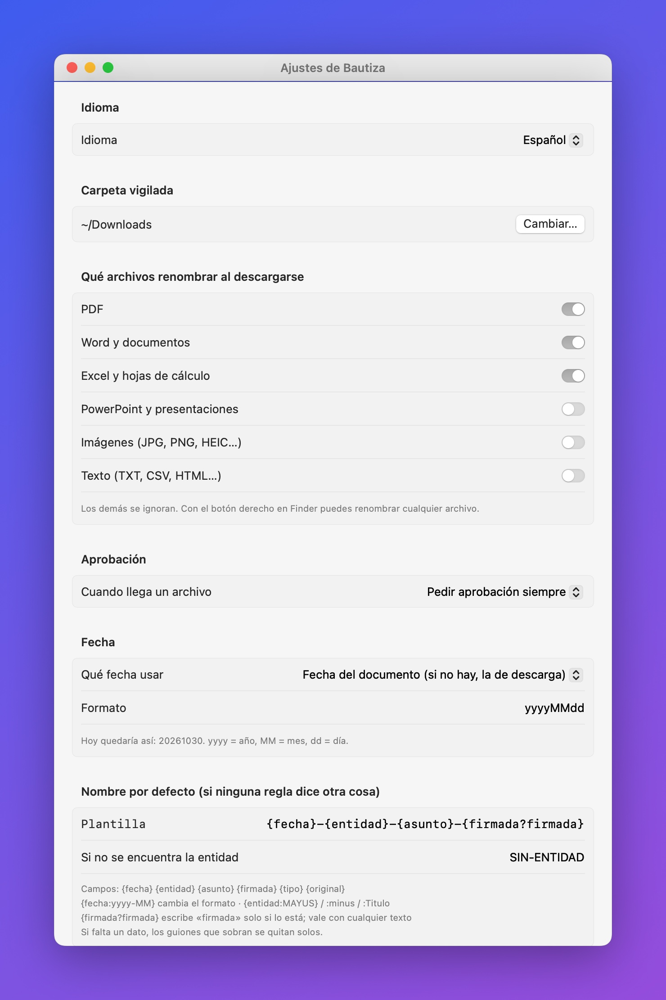

# Bautiza

**Tu carpeta de Descargas, con nombres que se entienden.**

Bautiza es una pequeña app para la barra de menús de macOS. Cada vez que descargas un archivo, lo lee y te propone un nombre ordenado:

```
pliego_licitacion_vehiculos_v2.pdf  →  20261026-AVON-Pliego de condiciones-firmada.pdf
scan0001.pdf                        →  20260903-AVON-Contrato de mantenimiento.pdf
documento (3).pdf                   →  20261020-Certificado literal de nacimiento.pdf
```



## Qué hace

- **Lee el documento**: PDF (también escaneados, con OCR), Word, Excel y PowerPoint.
- **Saca la fecha del documento**, no la de descarga: «En Madrid, a 26 de octubre» gana a «plazo hasta el 15/11».
- **Reconoce al cliente o proveedor** por su nombre, otros nombres o CIF. Si el documento es personal, lo deja sin entidad.
- **Sabe si está firmado** (firma digital del PDF, DocuSign, «Firmado digitalmente por…»).
- **Nombre a tu gusto** con plantillas: `{fecha}-{entidad}-{asunto}-{firmada?firmada}`.
- **Reglas**: «si pone *factura*, asunto Factura y muévelo a `~/Documents/Clientes/{entidad}`».
- **Tú decides**: te pide aprobación (o renombra solo), con deshacer e historial.
- **Botón derecho en Finder** → Acciones rápidas → *Renombrar con Bautiza*.
- **Todo en tu Mac**: no sube nada a ningún sitio. IA opcional de Apple, también local.
- En **español e inglés**.





## Instalar

Necesitas macOS 14 o posterior (Apple Silicon o Intel) y las Command Line Tools de Xcode (`xcode-select --install`).

```bash
git clone https://github.com/santipgv/bautiza.git
cd bautiza
./build.sh
mv build/Bautiza.app /Applications/
open /Applications/Bautiza.app
```

Aparecerá un icono en la barra de menús. Acepta los permisos de Descargas y notificaciones.

Para probar qué nombre pondría a un archivo sin tocarlo:

```bash
build/Bautiza.app/Contents/MacOS/Bautiza --probar ~/Downloads/algo.pdf
```

### IA de Apple (opcional)

Con Apple Intelligence activado y compilando con el SDK de macOS 26, Bautiza usa el modelo de Apple en tu Mac para resumir el asunto, distinguir documentos personales y resolver fechas dudosas. Le puedes dar instrucciones con tus palabras en Ajustes. Sin IA funciona igual, con reglas y el encabezado del documento.



## Cómo decide cada dato

| Dato | De dónde sale |
|---|---|
| Fecha | Fecha de emisión o firma del documento, descartando plazos, vencimientos y fechas de nacimiento. Si no hay, la de descarga (configurable). |
| Entidad | Tu lista de clientes y proveedores (nombre, alias, CIF; el encabezado pesa más). Si no está, una empresa S.A./S.L./Ltd del texto, marcada como duda. Las reglas pueden dejarla en blanco o fijarla. |
| Asunto | Asunto fijo de la regla → IA → título del PDF → encabezado («PLIEGO DE CONDICIONES») → nombre original. |
| Firmada | Firma digital del PDF, DocuSign, Signaturit, «Firmado digitalmente por»… |

## Código

App nativa en Swift + SwiftUI, sin dependencias.

- `FolderWatcher`: detecta archivos nuevos y espera a que termine la descarga
- `TextExtractor`: texto de PDF, OCR (Vision), Word, Excel, PowerPoint, web de origen
- `FieldResolver`: fecha, entidad, asunto, firma y regla
- `TemplateEngine`: plantillas
- `LocalAI`: Apple Foundation Models
- `Processor`: aprobación, renombrado, deshacer
- `MenuViews`, `SettingsViews`: interfaz; los textos van en `L("español", "english")`

Configuración e historial en `~/Library/Application Support/Bautiza/`.

---

### English

Bautiza is a tiny macOS menu bar app that reads every file you download (PDF, scanned PDF, Word, Excel, PowerPoint) and renames it from its content: document date, client or supplier, subject and whether it's signed, e.g. `20261026-AVON-Tender specs-signed.pdf`. Templates (`{date}-{entity}-{subject}-{signed?signed}`), rules, approval with undo, a Finder Quick Action, and optional on-device Apple AI. Everything stays on your Mac. Build it with `./build.sh` as described above.

## Licencia

[MIT](LICENSE)
